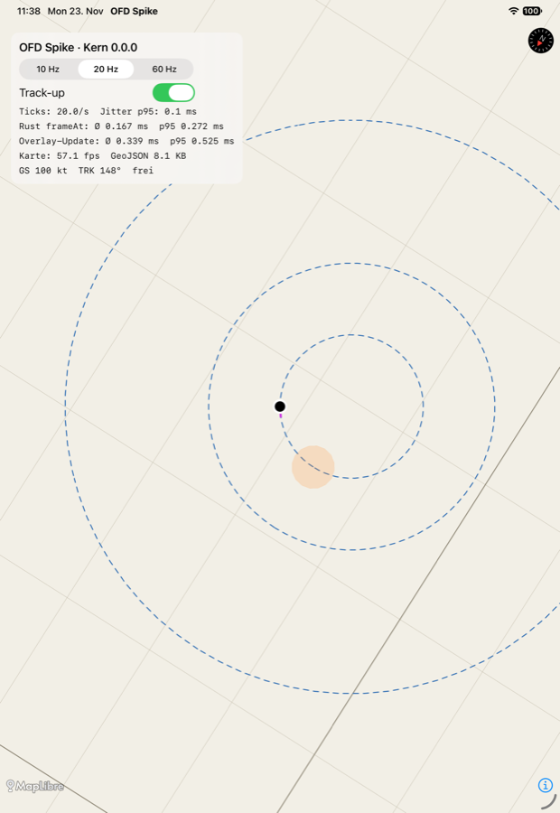

# Spike M1: UniFFI bei 10 bis 20 Hz und lokale PMTiles

Stand: 22.11.2026

Abnahmekriterium laut Implementierungsplan: Das iPad zeigt eine lokale PMTiles-Karte mit Overlay aus Rust bei 10 Hz flüssig.

## Offene Fragen

1. Bleiben UniFFI-Aufrufe mit Overlay-Updates bei 10 bis 20 Hz auf dem iPad flüssig?
2. Lädt MapLibre Native lokale PMTiles-Dateien aus dem App-Bundle zuverlässig?

## Aufbau

- **Kern:** `ofd_core::spike::SimulatedFlight` fliegt einen Kreis mit 5 km Radius um Schönhagen (EDAZ) bei 100 kt und liefert pro Aufruf eigene Position, Kurs, Status einer Warnzone und ein GeoJSON mit den letzten 300 Trackpunkten und dem Polygon der Warnzone (rund 8 KB). Bewusst ohne `ofd-units`, das Modul fliegt raus, sobald M2 bis M7 stehen.
- **Brücke:** `ofd-ffi` exportiert das Objekt per UniFFI-Proc-Macros. `cargo xtask ios` baut die statische Bibliothek für Gerät und Simulator, erzeugt die Swift-Bindings und packt beides als XCFramework in das Swift Package `apps/ios/OFDCore`.
- **App:** `apps/ios` (XcodeGen), SwiftUI mit MapLibre Native iOS 6.31.0. Die Karte kommt aus `spike.pmtiles` im Bundle über `pmtiles://file:///…`. Ein `CADisplayLink` ruft den Kern mit 10, 20 oder 60 Hz auf, setzt das GeoJSON als `MLNShapeSource`, zentriert die Karte und dreht sie bei Track-up.
- **Messung in der App** (eingeblendet und alle 2 s im Log unter `org.openflightdeck.spike`): tatsächliche Tick-Rate, Jitter (p95), Dauer von `frameAt` inklusive FFI, Dauer des Overlay-Updates in MapLibre und gerenderte Kartenframes pro Sekunde.

## Ergebnisse

Messung am 23.11.2026 im iOS-27.0-Simulator (iPad Pro 11 Zoll, M5) auf einem Mac mit Apple Silicon, Release-Build, Track-up an, Karte bei Zoom 10. Werte sind Mittel über rund 20 s, jeweils in 2-s-Fenstern; p95 ist das schlechteste Fenster ohne den Umschaltmoment.

| Rate | Tick-Rate | Jitter p95 | `frameAt` inkl. FFI Ø / p95 | Overlay-Update Ø / p95 | Karte |
| --- | --- | --- | --- | --- | --- |
| 10 Hz | 10,0/s | unter 0,6 ms (Ausreißer 19 ms) | 0,08 / 0,13 ms | 0,19 / 0,36 ms | 48 bis 59 fps |
| 20 Hz | 20,0/s | unter 0,13 ms | 0,19 / 0,29 ms | 0,38 / 0,62 ms | 55 bis 59 fps |
| 60 Hz | 60,0/s | unter 0,5 ms | 0,09 / 0,15 ms | 0,16 / 0,34 ms | 60 fps |

| Messung | Umgebung | Ergebnis |
| --- | --- | --- |
| Kernkosten pro Frame ohne FFI (`ofd spike-bench`, Release) | Mac, Apple Silicon | Ø 0,027 ms, p99 0,05 ms, max 0,12 ms bei 8,1 KB GeoJSON |
| App baut für Simulator und Gerät (arm64) | Xcode 27.0, iOS SDK 27.0 | ja |
| PMTiles lädt aus dem App-Bundle über `pmtiles://file:///…` | Simulator | ja, ohne Netz |
| Tick-Rate, Jitter, FFI- und Update-Dauer | Simulator | siehe Tabelle oben |
| Dieselbe Messung auf einem echten iPad | iPad | offen |

## Bewertung

Als flüssig gilt: Tick-Rate innerhalb 5 % des Sollwerts, Jitter p95 unter 10 ms, `frameAt` plus Overlay-Update p95 unter 8 ms (halbes 60-Hz-Frame), Karte ohne sichtbares Ruckeln bei Track-up.

- **Frage 1 (UniFFI bei 10 bis 20 Hz):** Im Simulator klar erfüllt. Rust-Aufruf und Overlay-Update zusammen bleiben auch bei 60 Hz unter 0,5 ms p95, also mehr als eine Größenordnung unter dem Budget. Die Tick-Rate trifft den Sollwert auf 0,3 %, die Karte rendert durchgehend mit 50 bis 60 fps. Einzelne Jitter-Ausreißer (bis 19 ms) treten beim Start und beim Umschalten der Rate auf.
- **Frage 2 (lokale PMTiles):** Erfüllt. MapLibre Native 6.31.0 lädt die gebündelte Datei über die vollständige `pmtiles://file:///…`-URL. Eine Falle beim Bündeln: Ein Ordner namens `Resources` in der Wurzel des App-Bundles macht das Bundle ungültig („Missing bundle ID“), die Datei muss flach ins Bundle.
- **Einschränkungen:** Der Simulator nutzt die GPU und CPU des Macs; ein echtes iPad kann langsamer sein. Das Overlay-Update misst nur den Main-Thread-Anteil, das Parsen des GeoJSON in MapLibre läuft danach im Hintergrund und steckt indirekt in den fps. Die Testkarte ist synthetisch und hat keine Beschriftungen.

**Ergebnis:** Die Architektur (Kern liefert pro Tick einen kompakten Zustand plus wenige KB GeoJSON, MapLibre liest die Karte direkt aus PMTiles) trägt. Für die formale Abnahme von M1 fehlt nur noch die Wiederholung auf einem echten iPad.
